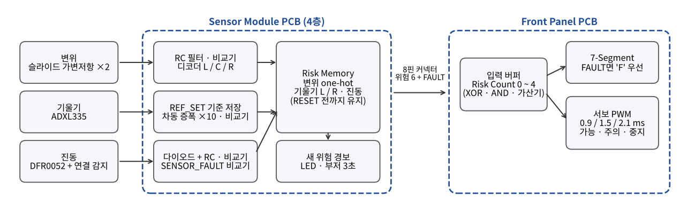
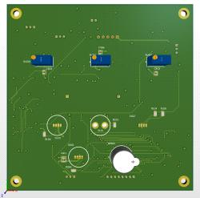
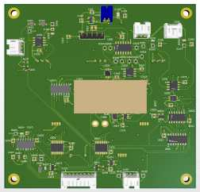
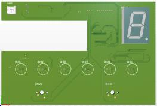
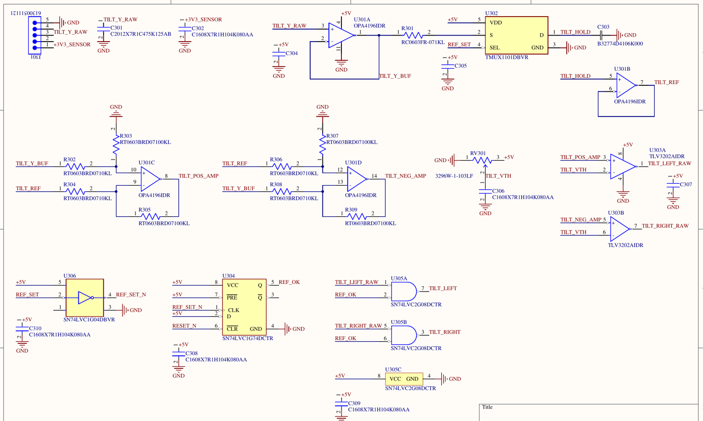
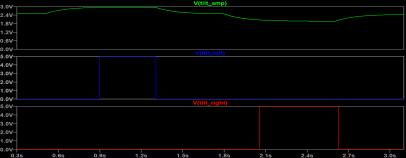
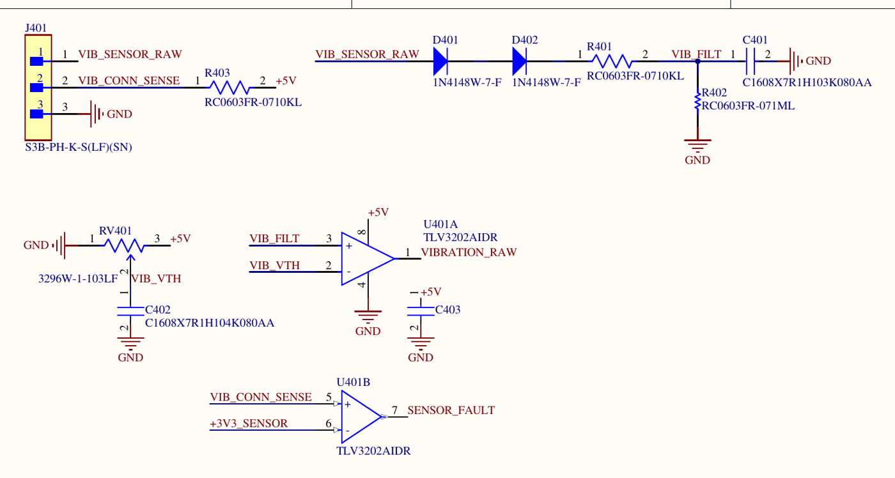
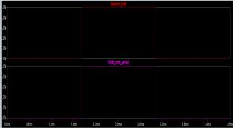
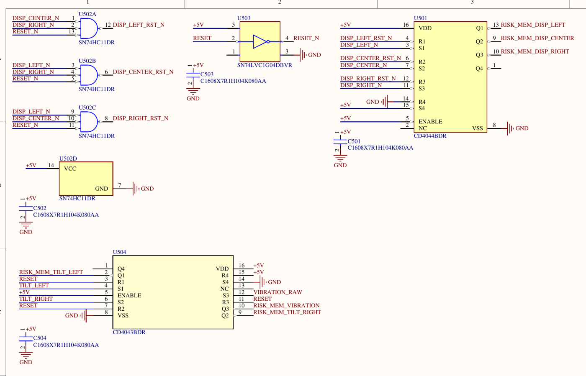
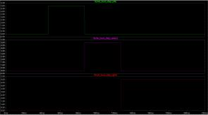

# SOC 해체공사 위험 감지·판단 시스템

변위 · 기울기 · 진동 센서 신호를 MCU 없이 아날로그 · 로직 회로만으로 판정하고, 위험 항목 수에 따라 작업 가능 / 주의 / 작업 중지를 표시하는 장치

고가차도 철거 중 붕괴 사고를 보고, 해체 중인 구조물의 이상을 현장에서 바로 알려주는 장치로 시작했다.

팀 프로젝트 · 2026 대한전자공학회 IT창의챌린지 · GitHub 업로드 2026.11 (실제 진행 과정과 날짜는 [개발 기록](docs/DEVELOPMENT_LOG.md))

<table align="center">
<tr>
<td align="center"> Sensor Module PCB (3D)</td>
<td align="center"> Sensor Module PCB 뒷면 (3D)</td>
<td align="center"> Front Panel PCB (3D)</td>
</tr>
</table>

---

## 시스템 구성

- Sensor Module PCB: 센서 신호 처리 → 위험 판정 → 위험 저장 → 새 위험 경보
  - 변위: 슬라이드 가변저항 2개를 임계값과 비교해 LEFT / CENTER / RIGHT 구분
  - 기울기: 설치할 때 자세를 기준값으로 저장하고, 거기서 얼마나 기울었는지로 LEFT / RIGHT 판정
  - 진동: 생활 진동은 거르고 충격만 이상 진동으로 판정. 센서 커넥터가 빠지면 SENSOR_FAULT
  - 저장: 위험이 사라져도 RESET 전까지 유지. 새 위험이 생기는 순간 LED · 부저 경보
- 두 보드는 GND + 디지털 신호 7개(위험 저장 6개 + SENSOR_FAULT)만 8핀 커넥터로 연결. 판정 · 저장은 Sensor Module에서 끝내고 Front Panel은 표시만 함
- Front Panel PCB: 위험 개수(Risk Count 0 \~ 4) 계산 → 7-Segment 숫자 표시, 서보로 작업 가능 / 주의 / 중지 표시

---

## 담당 역할 및 기여

**팀 프로젝트 | 개인 담당: Front Panel PCB 설계 · LTspice 회로 검증**

<table>
<tr><th align="center" width="160">담당 분야</th><th align="left">수행 내용</th></tr>
<tr><td align="center" width="160">시스템 설계 (팀 공동)</td><td align="left">Sensor Module / Front Panel 2보드 시스템 구조 설계 보드 간 인터페이스(신호 7개 + GND) 정의 센서 출력 특성 · 잡음 · 설치 환경에 따른 기준값 변화 검토</td></tr>
<tr><td align="center" width="160">Front Panel PCB 설계 (개인)</td><td align="left">Altium으로 입력 버퍼, Risk Count 계산, 7-Segment · SENSOR_FAULT 우선 표시 서보 PWM 제어 회로와 레이아웃 설계</td></tr>
<tr><td align="center" width="160">LTspice 회로 검증 (개인)</td><td align="left">센서 실측값을 입력으로 변위 · 기울기 · 진동 판정, 위험 저장, Count, 서보 PWM 회로 동작 검증</td></tr>
</table>

---

## 결과

<table>
<tr><th align="center">항목</th><th align="center">결과</th><th align="center" width="112">구분</th></tr>
<tr><td align="center">변위 센서 잡음</td><td align="center">RC 필터 적용 후 RMS 잡음 14.23 → 1.266 mV</td><td align="center" width="112">실측</td></tr>
<tr><td align="center">기울기 센서 출력</td><td align="center">기준 자세 대비 +10°에서 47 mV, −10°에서 −49 mV</td><td align="center" width="112">실측</td></tr>
<tr><td align="center">진동 센서 출력 (다이오드 + RC)</td><td align="center">생활 진동 최대 40 mV / 순간 충격 3.08 V</td><td align="center" width="112">실측</td></tr>
<tr><td align="center">위험 판정 · 저장 · Count</td><td align="center">변위 위치별 1곳만 저장, Count 0 → 4 이진 출력</td><td align="center" width="112">시뮬레이션</td></tr>
<tr><td align="center">서보 PWM</td><td align="center">목표 0.9 / 1.5 / 2.1 ms 대비 오차 0.3% 이내</td><td align="center" width="112">시뮬레이션</td></tr>
<tr><td align="center">PCB 설계 검증</td><td align="center">두 보드 모두 DRC 오류 0, 회로도–PCB 비교 차이 없음 (Altium 리포트)</td><td align="center" width="112">설계 검증</td></tr>
<tr><td align="center">제작 PCB 통합 동작</td><td align="center">두 보드 + 센서 + 서보를 연결한 전체 동작은 아직 확인 전</td><td align="center" width="112">미검증</td></tr>
</table>

- 판정 · 저장 · 표시 회로 결과는 중간보고서 기준 LTspice 시뮬레이션 값입니다. 제작한 PCB에서 전체 시스템을 연결한 통합 동작은 아직 검증하지 않았습니다.

---

## 핵심 문제 해결

아래 판정 · 저장 회로는 팀에서 함께 설계했습니다. 이 중 ③의 Count · 서보 회로는 제가 설계한 Front Panel PCB에 들어가고, 세 문제의 LTspice 검증은 제가 맡았습니다.

### ① 설치 자세마다 달라지는 작은 기울기 신호의 판정 문제

<table>
<tr>
<td align="center"> 수정한 회로: 기준값 저장 · 차동 증폭 · REF_OK 게이트</td>
<td align="center"> LEFT / RIGHT 판정 (LTspice)</td>
</tr>
</table>

<table>
<tr><td align="center" width="70">문제</td><td><ul><li>±10° 기울여도 ADXL335 출력 변화가 47 / −49 mV 수준으로 작음 (실측)</li><li>센서를 붙이는 자세가 매번 달라, 절대 출력값을 기준으로 삼으면 설치하자마자 위험으로 판정됨</li></ul></td></tr>
<tr><td align="center" width="70">원인</td><td><ul><li>위험 여부는 "지금 몇 도인가"가 아니라 "설치했을 때보다 얼마나 기울었나"로 정해야 하는데, 고정 임계값 하나로 비교하고 있었음</li></ul></td></tr>
<tr><td align="center" width="70">해결</td><td><ul><li>설치 후 REF_SET 버튼을 누르면 아날로그 스위치(TMUX1101)가 그 순간 전압을 커패시터에 저장 → 이 값을 "설치 기준값"으로 사용</li><li>지금 값과 기준값의 차이를 저항비(10 kΩ / 100 kΩ)로 약 10배 키운 뒤, 비교기(TLV3202) 두 개로 왼쪽 · 오른쪽 기울어짐을 따로 판정</li><li>기준값을 저장하기 전에는 기울기 경보가 나가지 않도록 플립플롭 + AND 게이트로 막음 (REF_OK)</li></ul></td></tr>
<tr><td align="center" width="70">결과</td><td><ul><li>정상 범위 (0, 0), 양의 방향 초과 (1, 0), 음의 방향 초과 (0, 1)로 좌우를 구분하고 두 출력이 동시에 켜지지 않음 (시뮬레이션)</li></ul></td></tr>
</table>

### ② 생활 진동과 충격의 구분, 그리고 센서가 빠졌을 때 "정상"으로 보이는 문제

<table>
<tr>
<td align="center"> 수정한 회로: 다이오드 + RC 진동 판정, 연결 감지 핀</td>
<td align="center"> 연결 → 분리 → 재연결 시 SENSOR_FAULT (LTspice)</td>
</tr>
</table>

<table>
<tr><td align="center" width="70">문제</td><td><ul><li>사람이 걷거나 장비가 지나가는 생활 진동까지 위험으로 판정하면 경보가 계속 울림</li><li>진동 센서 커넥터가 빠지면 출력이 0이 되어 "진동 없음"과 구분이 안 됨 → 위험해도 정상으로 표시될 수 있음</li></ul></td></tr>
<tr><td align="center" width="70">원인</td><td><ul><li>원신호는 생활 진동과 충격 모두 순간 피크가 있어 임계값 하나로 나누기 어려움</li><li>MCU가 없어 "신호가 한동안 안 들어옴"을 소프트웨어로 감시할 수 없음</li></ul></td></tr>
<tr><td align="center" width="70">해결</td><td><ul><li>진동 신호 앞에 다이오드 2개를 직렬로 넣어 작은 생활 진동은 깎고, RC 필터(10 kΩ · 10 nF)로 짧은 튐을 줄인 뒤 비교기로 판정</li><li>필터에 남은 전압을 빼주는 저항(1 MΩ)을 달아 다음 충격도 다시 감지되게 함</li><li>커넥터에 연결 감지 핀을 따로 둠: 보드 쪽은 +5 V로 풀업, 센서 쪽은 GND에 연결 → 커넥터가 빠지면 HIGH가 되어 SENSOR_FAULT 출력</li><li>SENSOR_FAULT일 때 7-Segment에 'F'를 띄우고, 다시 꽂으면 RESET 없이 정상으로 복귀</li></ul></td></tr>
<tr><td align="center" width="70">결과</td><td><ul><li>다이오드 + RC 적용 시 생활 진동 최대 40 mV, 순간 충격 3.08 V (실측)</li><li>시험 입력에서 생활 진동은 미출력, 충격에만 VIBRATION 출력 (시뮬레이션)</li><li>SENSOR_FAULT 0 → 1 → 0, 재연결 후 자동 해제 (시뮬레이션)</li></ul></td></tr>
</table>

### ③ 변위 위치가 바뀔 때 위험이 중복 집계되는 문제

<table>
<tr>
<td align="center"> 수정한 회로: 변위 one-hot 저장 (위) · 기울기 · 진동 저장 (아래)</td>
<td align="center"> LEFT → CENTER → RIGHT 이동 시 저장 출력 (LTspice)</td>
</tr>
</table>

<table>
<tr><td align="center" width="70">문제</td><td><ul><li>1차 설계는 위험 저장 신호 6개를 각각 더함 → 변위가 LEFT에서 CENTER로 옮겨가면 두 위치가 모두 저장돼 변위 하나가 위험 2개로 집계됨</li></ul></td></tr>
<tr><td align="center" width="70">원인</td><td><ul><li>LEFT / CENTER / RIGHT는 같은 상판의 위치 정보라 동시에 하나만 의미가 있는데, 기울기 · 진동처럼 독립 항목으로 저장하고 있었음</li></ul></td></tr>
<tr><td align="center" width="70">해결</td><td><ul><li>변위는 위치마다 래치(CD4044)를 두고, 다른 위치가 감지되면 이전 위치 기억을 자동으로 지우도록 연결 → 변위는 항상 한 위치만 저장</li><li>위험 항목을 변위 1 + 기울기 좌 · 우 + 진동 = 최대 4개로 다시 정하고, 가산기로 더해 Risk Count(0 ~ 4) 출력</li><li>Count 값에 따라 멀티플렉서(CD74HC4051)가 저항을 골라 서보 펄스 폭을 바꾸고, 타이머 IC(TLC556)가 작업 가능 / 주의 / 중지 각도의 서보 신호를 만듦</li></ul></td></tr>
<tr><td align="center" width="70">결과</td><td><ul><li>저장 출력 (1,0,0) → (0,1,0) → (0,0,1), 변위 Count는 계속 1 (시뮬레이션)</li><li>위험 0 → 4개일 때 COUNT 000 → 100, 서보 펄스폭 목표 대비 오차 0.3% 이내 (시뮬레이션)</li></ul></td></tr>
</table>

---

## 미해결 문제

### 제작 PCB에서의 통합 동작과 현장 조건 검증

<table>
<tr><td align="center" width="70">현재</td><td><ul><li>판정 · 저장 · 표시 회로는 LTspice로, 센서 특성은 실험으로 따로 확인한 상태</li><li>임계값(변위 · 기울기 · 진동)은 가변저항으로 손으로 맞추는 방식이라, 설치 환경이 바뀌면 다시 조정해야 함</li></ul></td></tr>
<tr><td align="center" width="70">우려</td><td><ul><li>상태가 바뀌는 순간(위험 발생 · RESET · 커넥터 재연결)에 로직 신호가 흔들려 잘못 저장될 가능성</li><li>MCU가 없어 위험 발생 시각이나 센서 원신호를 기록할 수 없음</li></ul></td></tr>
<tr><td align="center" width="70">계획</td><td><ul><li>제작한 PCB로 시연 구조물에서 변위 · 기울기 · 진동을 재현해 LED · Count · 서보 연동 확인</li><li>상태 전환 구간 파형을 오실로스코프로 측정해 오저장 여부 확인</li></ul></td></tr>
</table>

---

단계별 진행 기록: [docs/DEVELOPMENT_LOG.md](docs/DEVELOPMENT_LOG.md)
