# 개발 기록

## 0. 주제 잡기

- 고가차도 철거 중에 붕괴 사고가 난 걸 보고, 해체 중인 구조물이 이상해지는 걸 미리 알려주는 장치를 만들기로 했다.
- 재야 할 건 세 가지로 정했다. 상판이 내려앉는 변위, 구조물이 기우는 기울기, 갑자기 오는 충격 진동.
- MCU 없이 아날로그 · 로직 회로만으로 판정하고, 위험이 사라져도 기억하고, 몇 개인지 세서 보여주는 걸 목표로 잡았다.

---

## 1. 처음 설계안

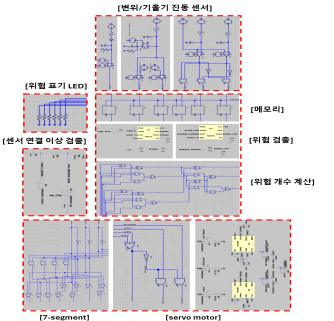

- 처음엔 센서 → 판정 → 위험 표시 LED → 메모리 → 위험 개수 계산 → 7-Segment · 서보를 한 덩어리로 그렸다.
- 위험 저장 신호 6개(변위 L/C/R, 기울기 L/R, 진동)를 각각 저장하고 그대로 더해서 개수를 세는 구조였다.

---

## 2. 센서부터 재봄

- 회로를 짜기 전에 센서 출력이 실제로 어떻게 나오는지부터 쟀다. 시뮬레이션 입력을 실측값으로 넣으려고.
- 변위 (슬라이드 가변저항): 잡음이 생각보다 컸다. RC 필터를 넣으니 RMS 잡음이 14.23 → 1.266 mV로 줄었다.

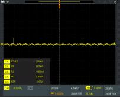

- 기울기 (ADXL335): 기준 자세에서 +10° 기울이면 47 mV, −10°면 −49 mV. 생각보다 너무 작았다. 그대로 비교기에 넣으면 잡음이랑 구분이 안 될 것 같았다.
- 진동 (DFR0052): 원신호는 생활 진동이든 충격이든 다 피크가 튀었다. 다이오드랑 RC 필터를 붙여보니 생활 진동은 최대 40 mV, 순간 충격은 3.08 V로 확 벌어졌다.

---

## 3. 1차 회로 LTspice 검증

- 센서 측정값을 입력으로 넣고 판정, 저장, 초기화, 경보, 개수, 표시 회로를 하나씩 돌려봤다.
- 변위는 두 센서가 임계값을 넘는 조합으로 LEFT / CENTER / RIGHT가 잘 나왔다.
- 기울기는 기준값을 저장하고 변화 방향에 따라 LEFT / RIGHT가 나왔다.
- 진동은 시험 입력에서 생활 진동엔 안 나오고 충격에만 VIBRATION이 나왔다.
- 서보는 스위치로 저항을 골라 작업 상태별 PWM을 만들어봤는데, 목표 펄스폭 0.9 / 1.5 / 2.1 ms 대비 오차 0.3% 이내였다.

---

## 4. PCB로 옮기려다 걸린 것들 (2차 설계)

### 변위가 두 번 세짐

- 상판을 LEFT에서 CENTER로 옮기면 LEFT도 저장돼 있고 CENTER도 저장돼서, 변위 하나가 위험 2개로 세졌다.
- 생각해보니 변위 위치는 같은 상판 얘기라서 동시에 하나만 의미가 있다. 기울기 · 진동처럼 따로따로 저장하면 안 됐다.
- 그래서 one-hot으로 바꿨다. 각 위치 래치의 Set에 그 위치 신호를 넣고, Reset에는 AND 게이트로 "다른 두 위치 신호 + RESET"을 넣었다. 새 위치가 잡히면 이전 위치가 알아서 풀린다.

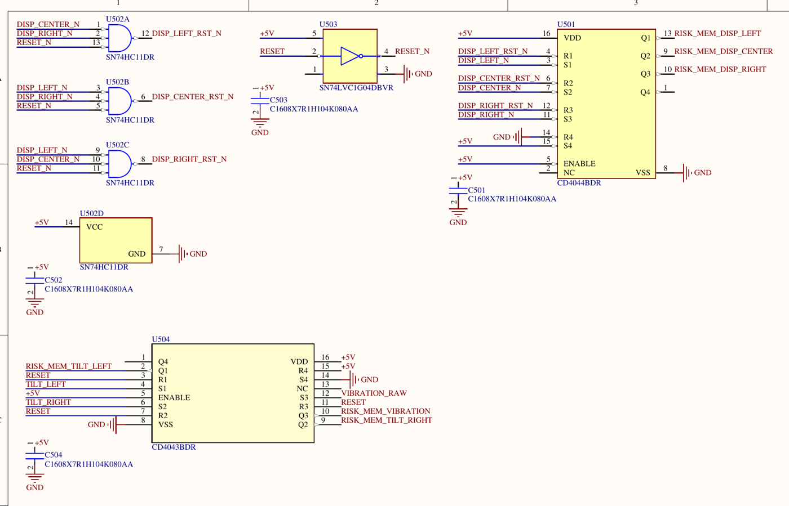

- LTspice로 LEFT → CENTER → RIGHT를 줘보니 저장 출력이 (1,0,0) → (0,1,0) → (0,0,1)로 바뀌고 변위 Count는 계속 1이었다.

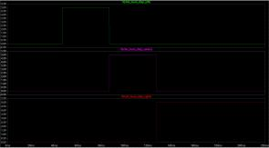

- 이걸 바꾸니까 최대 위험 개수도 6이 아니라 4가 됐다 (변위 1 + 기울기 L + 기울기 R + 진동).

### 기울기 기준을 어떻게 잡지

- 센서를 붙이는 자세가 매번 달라서, 절대 출력으로 기준을 정하면 붙이자마자 위험이 뜰 수 있었다.
- REF_SET 버튼을 누른 순간 전압을 저장해두고(TILT_HOLD → 버퍼 → TILT_REF), 지금 값과의 차이만 보기로 했다.
- 차이가 수십 mV라 10 kΩ / 100 kΩ로 10배 키우고, 극성이 반대인 출력 두 개로 양쪽 방향을 따로 비교했다.
- 기준값을 안 잡았는데 판정이 나오면 안 되니까, REF_SET 후에만 REF_OK가 켜지고 AND 게이트로 그때만 위험을 내보내게 했다.

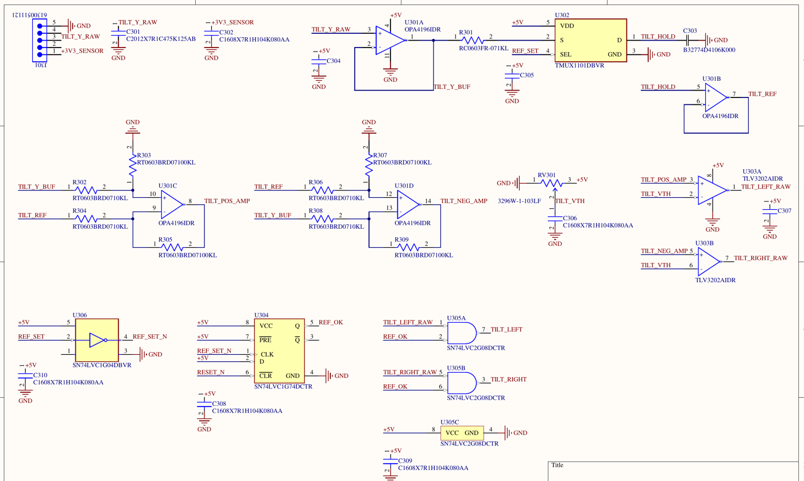

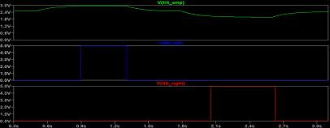

### 센서가 빠지면 "정상"으로 보임

- 진동 센서 커넥터가 빠지면 출력이 0이라 "진동 없음"이랑 똑같았다. 위험한데 정상으로 표시될 수 있는 상황이었다.
- MCU가 없으니 "한동안 신호가 없으면 이상"을 코드로 볼 수가 없었다.
- 커넥터에 감지 핀을 하나 더 뒀다. 보드 쪽은 10 kΩ로 +5 V에 풀업, 센서 쪽은 GND에 연결한다. 빠지면 HIGH가 돼서 비교기가 SENSOR_FAULT를 낸다. 신호가 없는 게 아니라 연결이 끊긴 걸 직접 잡는 방식이다.
- Front Panel에서는 SENSOR_FAULT면 7-Segment에 'F'를 우선 띄우고, 다시 꽂으면 RESET 없이 원래 Count로 돌아오게 했다.

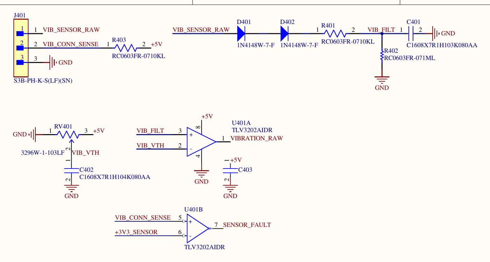

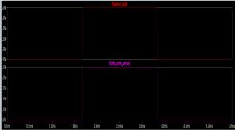

- 연결 → 분리 → 재연결에서 SENSOR_FAULT가 0 → 1 → 0으로 나왔다.
- 진동 필터 쪽은 다이오드 2개 + 10 kΩ · 10 nF로 작은 진동을 깎고, 1 MΩ로 필터 노드가 방전되게 해서 다음 충격도 다시 잡히게 했다.

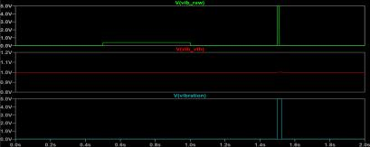

### 개수 세기랑 서보

- XOR · AND로 2개씩 묶어 합이랑 올림을 만들고, 4비트 가산기 2개로 COUNT2 \~ COUNT0을 냈다. 0 → 4개일 때 000 → 001 → 010 → 011 → 100이 나왔다.

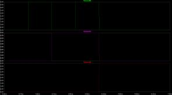

- 1차에선 스위치로 서보 저항을 골랐는데, 2차에선 Count를 아날로그 멀티플렉서(CD74HC4051) 선택 신호로 넣어서 저항이 자동으로 골라지게 했다. 8.2 kΩ → 0.9 ms(작업 가능), 13.7 kΩ → 1.5 ms(주의), 19.1 kΩ → 2.1 ms(작업 중지). Count 2 \~ 4는 다 작업 중지로 묶었다.

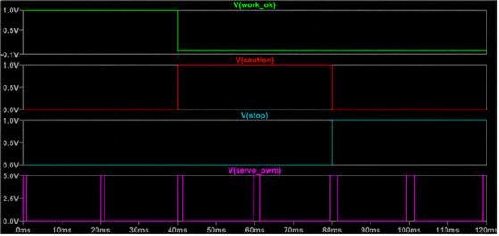

### 새 위험 경보

- 저장된 위험이 이전 상태랑 달라지는 순간만 울리게 했다. 이전 상태를 레지스터에 저장해두고 비교기로 현재 상태와 다르면 RISK_MISMATCH, RC 지연 + 슈미트 트리거로 클럭을 만들어 새 상태를 다시 저장한다.
- 타이머 두 개로 약 3초 동안, 1 Hz로 LED랑 부저를 깜빡이게 했다.

---

## 5. 보드 두 장으로 나눔

- 판정이랑 저장은 Sensor Module에서 다 끝내고, Front Panel은 저장된 결과로 세고 보여주기만 하게 나눴다.
- 두 보드 사이는 GND + 디지털 신호 7개(위험 저장 6개 + SENSOR_FAULT)만 8핀 커넥터로 연결했다. 인터페이스를 먼저 고정해두니까 보드를 나눠서 설계해도 맞추기 편했다.

| Sensor Module PCB | Front Panel PCB |
|:---:|:---:|
| 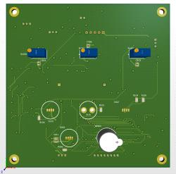 | 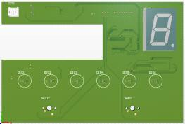 |
| 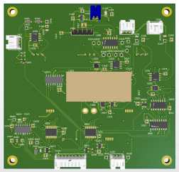 | 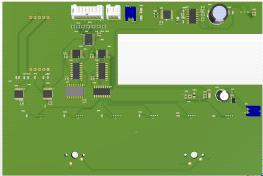 |

- Sensor Module은 4층으로 했다. 위아래는 신호, 안쪽은 GND 플레인이랑 +5 V 플레인.
- 선 폭은 일반 신호 약 0.25 mm, 로컬 전원 약 0.5 mm, 메인 +5 V 약 0.8 \~ 1.0 mm로 나눴고, 비아는 0.6 / 0.3 mm.
- 센서 원신호, 임계값, TILT_HOLD 같은 아날로그 신호는 최대한 짧게 깔았다.
- LED, 가변저항, 부저, 커넥터는 시연할 때 보고 만지기 쉽게 윗면이랑 가장자리에 뒀다.
- Front Panel은 7-Segment랑 상태 표시를 앞에서 잘 보이게 두고, 서보 전원은 로직 전원과 따로 뺐다.
- 두 보드 다 DRC 오류 0, Schematic–PCB 비교 No Differences까지 확인했다.

---

## 6. 시연용 구조물

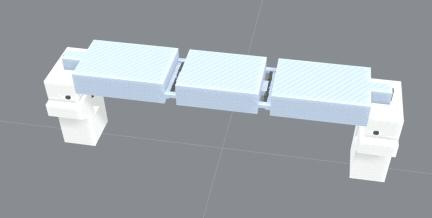

- 교량 상판이랑 지지부를 본떠서 만들고, 사이에 힌지를 넣어서 좌 · 중앙 · 우 각각 변위를 줄 수 있게 했다.
- 힌지를 회전축으로 써서 상판이 좌우로 기울어지게도 했다. 구조물 하나로 위치별 변위랑 기울기를 다 재현할 수 있다.
- 센서 모듈 · 프론트 패널 케이스는 Inventor로 그리고 3D 프린터로 뽑았다 (`enclosure/`).

---

## 7. 남은 것

- 중간보고서 시점엔 PCB 설계까지 끝났고, 제작한 PCB로 하는 기능 검증과 전체 통합 시연이 남아 있었다.
- 상태가 바뀌는 순간(위험 발생, RESET, 커넥터 재연결)에 로직이 흔들려서 잘못 저장되는지 실물에서 봐야 한다.
- 임계값을 가변저항으로 손으로 맞추는 방식이라, 현장이 바뀌면 다시 맞춰야 한다.

---

## 저장소 구성

```text
hardware/sensor-module/   Sensor Module PCB Altium 프로젝트 (회로도 6장, PCB, 회로도 PDF, 거버, DRC 리포트)
hardware/front-panel/     Front Panel PCB Altium 프로젝트 (회로도 2장, PCB, BOM, 회로도 PDF, 거버)
simulation/               판정 회로 LTspice 파일 (risk_circuit.asc)
enclosure/                3D 프린팅 케이스 (Inventor .ipt, 도면 DXF · PDF)
docs/images/              보고서 그림, 시뮬레이션 결과, PCB 3D 뷰
```

Sensor Module 회로도: `01_POWER_IO` 전원 · 입출력 / `02_DISPLACEMENT` 변위 / `03_TILT_REF` 기울기 기준 저장 · 판정 / `04_VIBRATION_FAULT` 진동 · 센서 분리 감지 / `05_RISK_MEMORY` 위험 저장 / `06_RISK_ALERT` 경보

Front Panel 회로도: `01_POWER_IO`, `02_SERVO`

주요 부품: OPA4196 (op-amp), TLV3202 (비교기), SN74HC273 / HC688 / HC11 / LVC 계열 로직, TLC556 (타이머), TLV70033 (LDO), SN74HC157 / HC86 / HC244 / HC08, CD74HC4051
